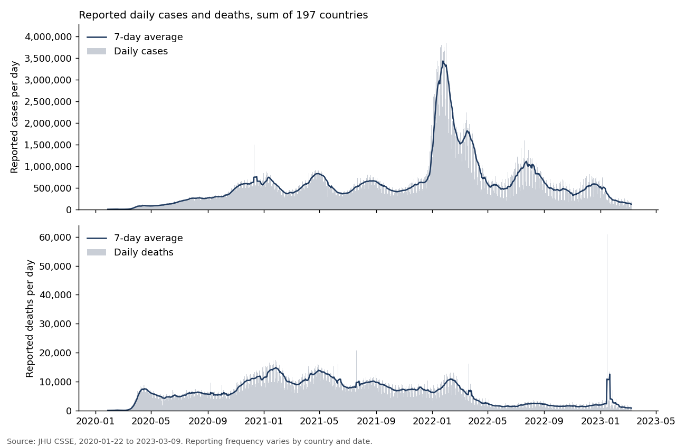
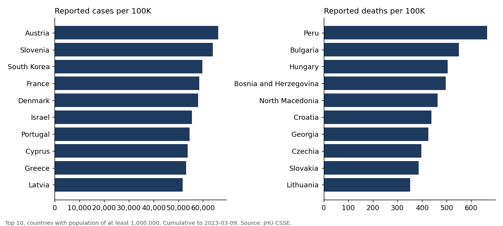

# COVID-19 Reported Cases and Deaths: Analytics Pipeline and Power BI Model

A reproducible data pipeline, validation framework and BI model built on the Johns Hopkins CSSE COVID-19 archive. Python cleans and validates the data, then produces a star-schema dataset for Power BI, an Excel workbook, a SQLite database with SQL queries, and generated quality and findings reports.

The Power BI report itself is not included: `powerbi/` holds the model, measures, theme and a page-by-page build guide. Charts in `outputs/` are Python charts of the data, not Power BI screenshots.

## Project Overview

| | |
|---|---|
| Rows in analytical table | 225,171 (197 countries x 1,143 days) |
| Columns in fact table | 11 |
| Validation | 24 checks: 18 PASS, 6 WARNING, 0 FAIL (see below) |
| Stack | Python (pandas, NumPy), SQL (SQLite), Excel, Power BI, DAX |

## Analytical Objectives

- Build a clean, documented country-by-day dataset from the raw JHU time series.
- Show how reported cases and deaths developed over time, by country and region.
- Compare countries with rates per 100K and case fatality ratio, with the caveats these need.
- Make data quality visible: every anomaly is counted and flagged rather than quietly removed.

## Dataset Source

Johns Hopkins University CSSE, COVID-19 Data Repository (global confirmed, deaths and recovered time series, plus the UID/ISO lookup table): https://github.com/CSSEGISandData/COVID-19. Regions come from https://github.com/datasets/country-codes. Download dates, URLs and hashes are in `data/raw/manifest.json`. The values are reported counts, not estimates. JHU stopped collecting global data on 2023-03-10.

## Coverage Period

2020-01-22 to 2023-03-09 (1,143 days). The first month (January 2020) starts on the 22nd and the last (March 2023) has 9 days.

## Geographic Coverage

197 countries and territories, each identified by ISO 3166-1 alpha-3 code, in five UN regions plus Antarctica. 91 province-level rows of 8 countries were summed to country level. Four non-geographic entries (Diamond Princess, MS Zaandam, two Olympic Games entries) were excluded and are listed in the quality report. Population is available for 196 of the 197 countries (not Antarctica).

## Tools

Python 3.12, pandas, NumPy, XlsxWriter, Matplotlib, SQLite, Excel, Power BI Desktop (DAX, Power Query).

## Architecture / Pipeline

```
raw JHU files -> ingest -> clean -> transform -> validate -> export
                                                              |-- data/processed/*.csv  (Power BI star schema)
                                                              |-- excel/covid_analysis.xlsx
                                                              |-- outputs/covid.db  (for sql/analysis.sql)
                                                              |-- reports/*.md, docs/data_dictionary.md
```

Single-source validation was used because the selected dataset provided the required historical coverage and multi-source reconciliation was not necessary for this implementation. Instead, the pipeline checks that country totals in the analytical table equal the raw file totals on every date (maximum difference: 0).

## Data Quality

Full results: `reports/data_quality_report.md`. Highlights from the last run:

- No duplicate rows, no duplicate country/date pairs, no missing dates, no non-numeric values, no negative cumulative values.
- **Recoveries are not usable after 2021-08-04.** The source series resets to zero the next day. 119,142 of 225,171 rows (52.9%) have no recovery figure, and 8 countries never reported any.
- **Downward revisions:** 171 country-days have negative daily cases (84 countries) and 199 have negative daily deaths (80 countries). They are kept as reported and flagged.
- **Impossible values:** 302 records have deaths above confirmed cases; 300 of them are North Korea (6 reported deaths against 1 confirmed case at most). 35 records have recoveries above confirmed cases. 459 records would give negative active cases, so Active is left blank for them. All are flagged, none changed.

## Analytical Model

Star schema in `data/processed/`:

| Table | Grain | Rows |
|---|---|---|
| `Fact_Covid` | country x date | 225,171 |
| `Dim_Date` | day (continuous) | 1,143 |
| `Dim_Country` | country | 197 |

Rates, rolling averages and ranks are DAX/SQL measures rather than stored columns because they depend on the slicer selection. Field definitions: `docs/data_dictionary.md`. Method: `docs/methodology.md`.

## Power BI Dashboard

`powerbi/README.md` specifies a five-page report (Overview, Global trends, Country comparison, Country detail with drill-through, Data quality and methodology) and a tooltip page, with each visual's type, fields, filters and position. `powerbi/measures.dax` has 44 measures (totals, daily values, 7-day averages, CFR, per-100K, peaks, period-over-period change, ranks, titles); `powerbi/power_query.m` loads the four tables; `powerbi/theme.json` sets the palette. The `.pbix` has not been built, and the DAX has not been run in Power BI Desktop.

## Key Metrics

Reported cases and deaths (cumulative and daily), 7-day average, case fatality ratio (reported deaths / reported cases), reported cases and deaths per 100K, peak daily and peak 7-day values, period-over-period change, rank by cases and deaths. Definitions are in the data dictionary and methodology.

## Key Findings

From `reports/key_findings.md` (calculated by the pipeline):

- At 2023-03-09 the 197 countries reported 676,568,028 cases and 6,881,787 deaths. The United States reported the most cases (103,802,702) and deaths (1,123,836), followed by India (44,690,738 cases) and Brazil (699,276 deaths, second).
- Among countries with at least 1 million people, reported cases per 100K were highest in Austria, Slovenia and South Korea; reported deaths per 100K were highest in Peru, Bulgaria and Hungary.
- The global 7-day average of reported daily cases peaked at 3,436,886 on 2022-01-24, well above the earlier peaks (826,677 on 2021-04-28; 1,111,743 on 2022-07-24 under a 120-day separation rule).
- Reported deaths: 1,901,762 in 2020, 3,567,242 in 2021, 1,224,357 in 2022, 188,426 in 2023 to March 9. Reported cases rose each year: 83.8 million, 204.9 million, 371.7 million and 16.1 million.
- The largest single-day death count (59,961, China, 2023-01-15) is surrounded by days with under 100 reported deaths, which points to a batch addition to the series rather than deaths on one day.





## Limitations

- Figures are what countries reported. Testing, case definitions, reporting frequency and death attribution differ between countries and changed over time, so cross-country differences are not differences in infection or mortality.
- Under-reporting is likely in many places and cannot be measured here.
- Many countries moved to weekly or irregular reporting in 2022 and 2023, so daily values are lumpy and include backlog and retrospective corrections.
- The case fatality ratio uses reported cases and deaths; it is not a risk of dying.
- Population is one figure per country with no stated reference year. Rates for countries below 1 million people are volatile.
- Recoveries and active cases are unavailable after 2021-08-04.
- The Excel "Pivot_Analysis" sheet is a formula-based cross-tab (SUMIFS), not a native PivotTable. The workbook has not been deployed to Google Sheets.

## Reproduction Instructions

```
python -m venv .venv
.venv\Scripts\activate          # Windows (macOS/Linux: source .venv/bin/activate)
pip install -r requirements.txt
python run_pipeline.py
```

Tested with Python 3.12, pandas 3.0.2, NumPy 2.4.4, XlsxWriter 3.2.9 and Matplotlib 3.10.8. This downloads the raw files (internet needed on the first run), cleans and validates them, and writes all outputs. `python run_pipeline.py --refresh` downloads the raw files again. To run the SQL: `sqlite3 outputs/covid.db < sql/analysis.sql`, or open `outputs/covid.db` in any SQLite client.

## Repository Structure

```
.
├── README.md
├── LICENSE
├── requirements.txt
├── run_pipeline.py
├── src/            config, ingest, clean, transform, validate, export, dictionary
├── data/
│   ├── raw/        downloaded files (CSVs ignored) and manifest.json
│   └── processed/  Fact_Covid, Dim_Date, Dim_Country, DQ_Checks (CSV)
├── sql/analysis.sql
├── excel/covid_analysis.xlsx
├── powerbi/        README.md (build guide), measures.dax, power_query.m, theme.json
├── reports/        data_quality_report.md, key_findings.md
├── docs/           methodology.md, data_dictionary.md
└── outputs/        charts, key_findings.json (covid.db is generated and ignored)
```
