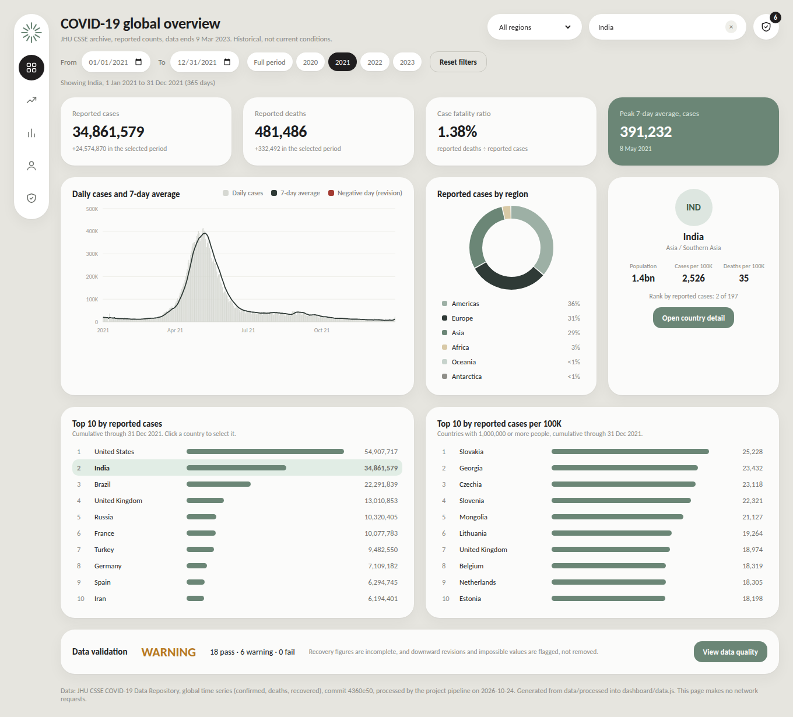

# Interactive dashboard

A self-contained HTML, CSS and JavaScript dashboard for the processed COVID-19 data. It runs from a local file, needs no server, no internet connection and no library, and makes no network requests.



Screenshot of the running dashboard (Chromium) with India and the year 2021 selected.

## Open it

Windows PowerShell, from the repository root:

```powershell
Start-Process chrome (Resolve-Path .\dashboard\index.html).Path
```

If `chrome` is not found, use the default browser, the full Chrome path, or a local server:

```powershell
Invoke-Item .\dashboard\index.html
Start-Process "C:\Program Files\Google\Chrome\Application\chrome.exe" (Resolve-Path .\dashboard\index.html).Path
python -m http.server 8000 --directory dashboard      # then open http://localhost:8000
```

## Files

| File | Purpose |
|---|---|
| `index.html` | Page structure for the five pages |
| `styles.css` | Layout, colours, responsive rules |
| `charts.js` | SVG charts (time series, monthly bars, donut) and tooltips |
| `app.js` | State, filters, navigation, calculations and rendering |
| `data.js` | Generated data (see below). Do not edit by hand |

## Where the data comes from

`data.js` is generated by `src/build_dashboard.py` at the end of `python run_pipeline.py`, from the same in-memory tables that are written to `data/processed/`. It holds, for each of the 197 countries: daily cases, daily deaths, cumulative recoveries (null where unavailable) and the day numbers flagged with `Revision_Flag` and `Inconsistency_Flag`; plus the country attributes, the validation results and the source details. A script tag loads it, because browsers do not let a page opened from a file read CSV files directly. Cumulative values are rebuilt in the browser by adding up the daily values, and `tests/test_outputs.py` checks that this reproduces the processed tables exactly.

## Pages

| Page | What it shows |
|---|---|
| Overview | Reported cases and deaths, case fatality ratio, peak 7-day average, daily cases with 7-day average, cases by region, selected-country summary, top 10 by cases and per 100K, validation status |
| Trends | Daily cases and deaths with 7-day averages, monthly totals, cumulative curves |
| Compare | Searchable, sortable table of all countries; click a row to select the country |
| Country | Header, KPIs, trends, peaks and data notes for the selected country |
| Quality | Coverage and source, validation results, counts for the current selection, recovery coverage, methodology |

## Filters

- **Region** and **country** (searchable list in the header). Choosing a country outside the selected region clears the region; choosing a region clears a country outside it.
- **From / To** dates and year presets. Moving one date past the other moves both.
- **Reset filters** restores all regions and countries, the full date range, an empty table search, the default sort and the warnings toggle.
- Clicking a country in a ranking, the comparison table or the country list selects it. Clicking a region in the donut or its list filters by that region.

## How the numbers are calculated

- **Reported cases / deaths**: cumulative total on the last selected date, summed over the selected countries. The note under each card shows the change within the selected period.
- **Case fatality ratio**: reported deaths divided by reported cases on the last selected date. n/a when there are no reported cases.
- **7-day average**: mean of the last seven daily values, calculated over the full series, so the first days of a selected range use days before the range. **Peak** is the highest value inside the selected range.
- **Per 100K**: cumulative cases or deaths divided by population times 100,000, using only countries that have a population value (numerator and denominator cover the same countries). n/a when none do.
- **Rankings**: use the region filter and the last selected date; the per-100K ranking uses countries with at least 1,000,000 people.
- **Daily values** are changes in a country's cumulative total, so a negative day is a downward revision. It is kept, drawn in red and counted on the Quality page. It is never set to zero.
- **Recoveries** are blank, never zero, where the source has none (after 4 Aug 2021 for every country, earlier for four countries, never for nine). The recovery card shows the last available value and its date.

## Tests

Without extra software (checks that `data.js` matches the processed tables):

```powershell
python -m unittest discover tests -v
```

The browser tests drive the page in headless Chromium and compare what is displayed with numbers calculated from the CSV files. They are skipped unless Playwright is installed:

```powershell
pip install playwright
python -m playwright install chromium
python -m unittest tests.test_dashboard_browser -v
```

They cover page navigation and deep links, country selection (search box, rankings, table, region chart, keyboard), region and date filters, presets and invalid ranges, search and sorting, reset, tooltips, revision and missing-value handling, window resize, the phone layout, and a check that changing `data.js` changes what the page shows.

## Limits

- Tested in headless Chromium, which uses the same engine as Chrome; not tested in Chrome on Windows, Firefox, Safari or on a physical phone.
- The data ends on 9 Mar 2023 and is not current.
- The comparison table shows cumulative values through the last selected date; the first date only affects the period figures and charts.
- The default view is the full period, so period changes and the previous-period comparison from the Power BI design are not part of this page.
