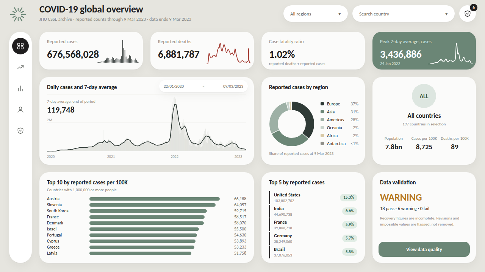

# Overview page: design and build guide

Target: the page in `preview/overview_preview.png` (open `preview/overview.html` in a browser to inspect it). The preview is a static HTML mock-up generated from this project's data; the Power BI page is built by hand to match it. All positions below are the preview's positions, in pixels on a 1280 x 720 canvas, so the two line up one to one.

## 1. Reference and what was kept

The design follows the supplied reference video (a light dashboard with a floating icon rail, search pill, four KPI cards with one dark accent card, a wide chart card beside two side cards, and a bottom row of three cards). The video is low resolution, so colours were sampled from compressed frames and are approximate; the typeface in the video was not identified.

| Reference element | In this page |
|---|---|
| Greige page, near-white cards, 24 px corners, soft shadow | Same. Page `#E6E5DF`, cards `#FBFBFA` |
| Left icon rail with dark active circle | Same, five icons for the five report pages |
| Greeting and subtitle | Title "COVID-19 global overview" and a dynamic subtitle |
| Search pill, round icon buttons | Country slicer (search on) and Region slicer as pills; one round button that opens Data quality, with a badge showing the number of warnings |
| Four KPI cards, sparkline, accent card in sage | Reported cases, reported deaths, case fatality ratio, peak 7-day average (accent) |
| Balance chart with "Monthly" dropdown | Daily cases with 7-day average; the dropdown becomes a date range slicer |
| Earnings donut | Reported cases by region |
| Profile card | Selection card: ISO code badge, country name, population and per-100K rates |
| Transfers list | Top 5 countries by reported cases |
| Credit card panel and "Keep you safe" card | Top 10 per 100K bar chart and a data validation card |

Not reproduced, because they have no data behind them or add nothing: the animated assistant orb, avatar image, card illustrations, notification count, settings/theme/logout icons, entrance animations.

## 2. Design tokens

| Token | Value |
|---|---|
| Canvas | 1280 x 720 |
| Page background | `#E6E5DF` |
| Card fill / border | `#FBFBFA` / same colour, corner radius 24 |
| Card shadow | Outer, colour `#28281E`, transparency 95%, blur 24, distance 8, angle 90 |
| Text | primary `#201E1F`, muted `#8A8A85` |
| Accent (sage) | `#6B8676`; on accent card text `#FFFFFF`, labels `#DCE6DF` |
| Active rail circle | `#201E1F` |
| Cases / deaths series | cases `#2F3A36`, deaths `#A33B32`, daily columns `#D6D8D2`, mini bars `#454B49` |
| Positive chip | fill `#E1EDE5`, text `#3E6B53` |
| Validation colours | warning `#B7791F`, pass `#2F6F4F`, fail `#A33B32` |
| Region colours | Europe `#2F3A36`, Asia `#6B8676`, Americas `#9DB0A5`, Oceania `#C7D3CC`, Africa `#D8C9A6`, Antarctica `#8F8F89` |
| Font | Segoe UI (Power BI default). Sizes: page title 26 semibold, card title 15 semibold, big value 28 semibold, labels 13 muted, notes 10.5 to 11 muted |

`theme.json` sets the page background, card fill, radius and palette; apply it first (View > Themes > Browse for themes). Option names can differ slightly between Desktop versions; where a setting is missing, the property described is what matters.

## 3. Build order

Before starting: model loaded, relationships created and the measures below added (see `README.md` sections 1 to 3).

1. Page 1 canvas: Format page > Canvas settings > Type Custom 1280 x 720. Confirm Canvas background is `#E6E5DF`, transparency 0%.
2. Build the **rail** (R1 to R7), then the **header** (H1 to H7).
3. Build **one KPI card** completely (K1), including shadow and radius, then copy and paste it three times and change field, label, position. Format painter copies the style to the other cards and charts.
4. Build the overlay charts (K1c, K2c, K4c) after their cards, then use Selection pane to keep them above the cards.
5. Build row 2 (T1 to T3, D1, P1 to P7), then row 3 (B1, L1, Q1 to Q5).
6. Create the slicer sync (View > Sync slicers) once Date, Region and Country slicers exist.
7. Compare with the preview and with the expected values in section 6.

Measures used on this page: Total Cases, Total Deaths, Case Fatality Ratio, Peak 7-Day Average Cases, Peak 7-Day Average Cases Date, Daily Cases, 7-Day Average Cases, 7-Day Average Deaths, Selected ISO Code, Selected Country, Countries Label, Population, Cases Per 100K, Deaths Per 100K, Share of Global Cases, Overall DQ Status, DQ Status Text, DQ Status Color, DQ Warning Checks, Subtitle Overview, Selected End Date, Latest Data Date, DQ Pass Checks, DQ Fail Checks, Countries Covered. Their definitions and dependencies are in `measures.dax`.

## 4. Visuals

Assets: `powerbi/assets/icons/*.svg` (and `.png` copies). Use the SVG for button icons (Format > Style > Icon > Shape > Custom); use the PNG if your Desktop rejects the SVG.

### Rail and header

| ID | Visual | Content | x, y, w, h | Formatting |
|---|---|---|---|---|
| R1 | Shape: rounded rectangle | none | 24, 84, 60, 612 | Fill `#FFFFFF`, no outline, corner radius 30, shadow as tokens |
| R2 | Shape: oval | none | 32, 100, 44, 44 | Fill `#201E1F`, no outline. Sits behind the active page icon (move it on other pages) |
| R3 | Button (blank) | icon `overview_white.svg`, action Page navigation > Overview | 32, 100, 44, 44 | Fill transparent, no outline |
| R4 | Button | icon `trends_dark.svg`, Page navigation > Global trends | 32, 156, 44, 44 | same |
| R5 | Button | icon `compare_dark.svg`, Page navigation > Country comparison | 32, 212, 44, 44 | same |
| R6 | Button | icon `country_dark.svg`, Page navigation > Country detail | 32, 268, 44, 44 | same |
| R7 | Button | icon `quality_dark.svg`, Page navigation > Data quality | 32, 324, 44, 44 | same |
| H1 | Image | `logo.svg` | 24, 14, 48, 48 | Alt text "Logo" |
| H2 | Text box | "COVID-19 global overview" | 104, 8, 560, 40 | Segoe UI Semibold 26, `#201E1F`, no fill, no outline |
| H3 | Card (new) | `[Subtitle Overview]` | 104, 46, 620, 22 | Value 12, `#8A8A85`, label off, no fill, no outline |
| H4 | Slicer | `Dim_Country[Region]` | 748, 14, 170, 44 | Style Dropdown, multi-select, slicer header off, value font 13 `#6F6F6A`, fill white, outline white, radius 24, shadow on |
| H5 | Slicer | `Dim_Country[Country]` | 930, 14, 270, 44 | Style Dropdown, multi-select, search on, header off, same look as H4. Placeholder reads as the search field |
| H6 | Button | icon `quality_dark.svg`, Page navigation > Data quality, tooltip "Data quality" | 1212, 14, 44, 44 | Shape oval, fill white, shadow on |
| H7 | Card (new) | `[DQ Warning Checks]` | 1240, 8, 22, 22 | Fill `#201E1F`, radius 11, value white 10 bold centred, label off. Shows the warning count |

### Row 1: KPI cards (y = 84, h = 100, w = 273; x = 104, 397, 690, 983)

All four are Card (new) with the card style from the tokens (fill, radius 24, shadow), value font 28 Segoe UI Semibold, value display units None, category label on, 13, `#8A8A85`, label above the value, left aligned, padding 20.

| ID | Visual | Field | x, y, w, h | Specific formatting |
|---|---|---|---|---|
| K1 | Card (new) | `[Total Cases]` | 104, 84, 273, 100 | Label "Reported cases". Number format `#,0` |
| K1c | Clustered column chart (overlay) | X `Dim_Date[Year_Month]`, Y `[Daily Cases]` | 250, 106, 118, 60 | Title, legend, both axes, gridlines and data labels off. Background and border off. Columns `#454B49`, inner padding 35%. Purpose: monthly new cases, shape only |
| K2 | Card (new) | `[Total Deaths]` | 397, 84, 273, 100 | Label "Reported deaths". `#,0` |
| K2c | Line chart (overlay) | X `Dim_Date[Date]`, Y `[7-Day Average Deaths]` | 543, 114, 118, 56 | Everything off as K1c. Line `#A33B32`, width 1.5, no markers, X axis type Continuous |
| K3 | Card (new) | `[Case Fatality Ratio]` | 690, 84, 273, 100 | Label "Case fatality ratio". Format `0.00%` |
| K3n | Text box | "reported deaths ÷ reported cases" | 710, 160, 240, 18 | 10.5, `#8A8A85`, no fill |
| K4 | Card (new) | `[Peak 7-Day Average Cases]` | 983, 84, 273, 100 | Fill and outline `#6B8676`, value `#FFFFFF`, label "Peak 7-day average, cases" `#DCE6DF`. `#,0` |
| K4n | Card (new) | `[Peak 7-Day Average Cases Date]` | 1003, 160, 150, 20 | Date format `d mmm yyyy`, 10.5, `#DCE6DF`, label off, no fill |
| K4c | Line chart (overlay) | X `Dim_Date[Date]`, Y `[7-Day Average Cases]` | 1129, 114, 118, 56 | Everything off as K2c. Line `#FFFFFF`, width 1.5 |

### Row 2 (y = 204, h = 232)

| ID | Visual | Fields | x, y, w, h | Formatting |
|---|---|---|---|---|
| T1 | Line and clustered column chart | X `Dim_Date[Date]` (Continuous), column Y `[Daily Cases]`, line Y `[7-Day Average Cases]` | 104, 204, 566, 232 | Title "Daily cases and 7-day average", 15 semibold, left. Columns `#D6D8D2`, line `#2F3A36` width 1.8, no markers. Legend off, data labels off. X axis labels 10 `#9A9A94`, no title; Y axis labels 10 `#9A9A94`, display units Millions, no title; horizontal gridlines `#EDEDE8`. Tooltip: Report page `Tooltip - Day`. Sort: Date ascending |
| T2 | Slicer | `Dim_Date[Date]` | 420, 212, 234, 32 | Style Between, Slider off, header off, font 11, fill white, radius 16, shadow on. Synced across pages |
| T3 | Card (new) | `[7-Day Average Cases]` | 124, 258, 190, 56 | Label "7-day average, end of period" 10.5 `#8A8A85`; value 22 semibold, `#,0`; no fill, no outline, no shadow |
| D1 | Donut chart | Legend `Dim_Country[Region]`, Values `[Total Cases]` | 690, 204, 273, 232 | Title "Reported cases by region". Inner radius 70%. Slice colours per Region as in the tokens. Legend right, font 11. Detail labels: Percent of total, 10 (small slices fall back to the tooltip). Sort by `[Total Cases]` descending. Subtitle "Share of reported cases" if your version has one |
| P1 | Shape: rounded rectangle | none | 983, 204, 273, 232 | Fill `#FBFBFA`, radius 24, shadow as tokens |
| P2 | Shape: oval | none | 1087, 222, 64, 64 | Fill `#DDE6E0`, no outline |
| P2t | Card (new) | `[Selected ISO Code]` | 1087, 222, 64, 64 | Value 16 semibold `#3E5B49`, centred, label off, no fill, no outline |
| P3 | Card (new) | `[Selected Country]` | 983, 296, 273, 28 | Value 17 semibold, centred, label off, no fill |
| P4 | Card (new) | `[Countries Label]` | 983, 324, 273, 20 | Value 11.5 `#8A8A85`, centred, label off, no fill |
| P5 | Card (new) | `[Population]` | 999, 360, 80, 64 | Label "Population" 10.5 above; value 19 semibold, display units Billions, 1 decimal |
| P6 | Card (new) | `[Cases Per 100K]` | 1079, 360, 80, 64 | Label "Cases per 100K"; value 19 semibold, `#,0` |
| P7 | Card (new) | `[Deaths Per 100K]` | 1159, 360, 80, 64 | Label "Deaths per 100K"; value 19 semibold, `#,0` |

P5 to P7: no fill, no outline, no shadow, text centred.

### Row 3 (y = 456, h = 240)

| ID | Visual | Fields | x, y, w, h | Formatting |
|---|---|---|---|---|
| B1 | Clustered bar chart | Y `Dim_Country[Country]`, X `[Cases Per 100K]` | 104, 456, 566, 240 | Title "Top 10 by reported cases per 100K"; subtitle "Countries with 1,000,000 or more people" (or put that line in the title). Filters on this visual: `Dim_Country[Population]` greater than or equal to 1000000; `Dim_Country[Country]` Top N 10 by `[Cases Per 100K]`. Sort `[Cases Per 100K]` descending. Bars `#6B8676`, inner padding 35%. Data labels on, outside end, 11, `#6F6F6A`, `#,0`. Y axis labels 11.5 `#201E1F`, no title. X axis off, gridlines off, legend off |
| L1 | Table | `Dim_Country[Country]`, `[Total Cases]`, `[Share of Global Cases]` | 690, 456, 273, 240 | Title "Top 5 by reported cases". Filter `Dim_Country[Country]` Top N 5 by `[Total Cases]`. Sort `[Total Cases]` descending. Style: none, grid off, header text 10.5 `#8A8A85` with no fill, row padding 8. Country 12.5 semibold; Total Cases 10.5 `#8A8A85` `#,0`; Share of Global Cases format `0.0%`, Cell elements > Background colour > Rules: value greater than or equal to 0 then `#E1EDE5`, and the same rule for font colour `#3E6B53` |
| Q1 | Shape: rounded rectangle | none | 983, 456, 273, 240 | Card style |
| Q2 | Text box | "Data validation" | 1003, 474, 200, 24 | 15 semibold |
| Q3 | Card (new) | `[Overall DQ Status]` | 1003, 504, 233, 44 | Value 26 semibold, font colour: fx > Format style Field value > `[DQ Status Color]`; label off; no fill |
| Q4 | Card (new) | `[DQ Status Text]` | 1003, 548, 233, 24 | Value 12.5, `#201E1F`, label off, no fill |
| Q5 | Text box | "Recovery figures are incomplete. Revisions and impossible values are flagged, not removed." | 1003, 574, 233, 50 | 10.5 `#8A8A85`, no fill |
| Q6 | Button | text "View data quality", Page navigation > Data quality | 999, 640, 241, 40 | Fill `#6B8676`, text `#FFFFFF` 13 semibold centred, radius 14, no outline |

## 5. Interactions

- View > Sync slicers: Date (T2), Region (H4), Country (H5) synced and visible on pages Overview, Global trends and Country comparison; Country detail syncs Date only.
- Overlay charts K1c, K2c, K4c: Format > Edit interactions, set them to not filter other visuals (click the "None" icon on every other visual) so an accidental click cannot filter the page.
- Cross-filtering from B1, D1 and L1 to the cards and T1 is left on (default).
- Drill-through: right-click a country in B1 or L1 > Drill through > Country detail (configured on that page, see `README.md`).
- T1 and K-chart tooltips: T1 uses the report page tooltip `Tooltip - Day`.
- Selection pane order, top to bottom: header and badge, overlays (K1c, K2c, K4c), cards and text, slicers, shapes, rail.

## 6. Expected values in the default state (all countries, full date range)

If the page shows these, the measures, model and filters are wired correctly. They are calculated from `data/processed` by the pipeline code.

| Item | Expected value |
|---|---|
| Reported cases | 676,568,028 |
| Reported deaths | 6,881,787 |
| Case fatality ratio | 1.02% |
| Peak 7-day average, cases | 3,436,886 on 24 Jan 2022 |
| 7-day average, end of period | 119,748 |
| Cases by region | Europe 37%, Asia 31%, Americas 28%, Oceania 2%, Africa 2%, Antarctica <1% |
| Selection badge | ALL, All countries, 197 countries in selection |
| Population / cases per 100K / deaths per 100K | 7.8bn / 8,725 / 89 |
| Top 10 per 100K (population of 1,000,000 or more) | Austria 66,188; Slovenia 64,057; South Korea 59,715; France 58,517; Denmark 58,070; Israel 55,500; Portugal 54,630; Cyprus 53,893; Greece 53,233; Latvia 51,758 |
| Top 5 by cases (share of global) | United States 103,802,702 (15.3%); India 44,690,738 (6.6%); France 39,866,718 (5.9%); Germany 38,249,060 (5.7%); Brazil 37,076,053 (5.5%) |
| Data validation | WARNING, 18 pass, 6 warning, 0 fail; badge shows 6 |
| Subtitle | JHU CSSE archive \| reported counts through 9 Mar 2023 \| data ends 9 Mar 2023 |

## 7. Not verified

The page has not been built in Power BI Desktop, so the pixel positions, option names and the behaviour of the overlay charts are untested. The HTML preview renders in a browser with Segoe UI/Carlito-class fonts and was checked for text overflow with a wider fallback font. Layering sparkline charts over cards is a standard technique but depends on the Selection pane order. If a measure or format option is rejected, `sql/analysis.sql` shows the intended calculation.
